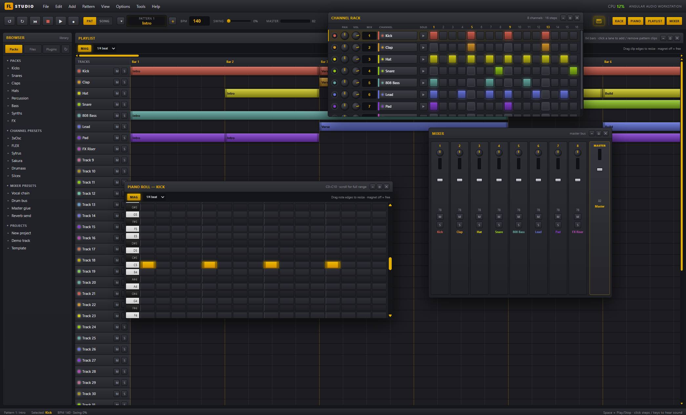

# FL Studio–Style DAW



An Angular + Flask music workstation with a channel rack, piano roll, mixer, browser and a Web Audio synth engine.

## Run

```bat
run.bat
```

- Frontend: http://localhost:4200 (Angular 17 dev server, binds `0.0.0.0`)
- Backend: http://localhost:5000 (Flask library API + songs CRUD)

## Panels

The **Channel Rack**, **Piano Roll** and **Mixer** are independent windows.

### Docked layout

- All three panels start docked inside the workspace.
- Drag the divider between the Channel Rack and Piano Roll to change the rack height.
- Drag the divider left of the Mixer to change the mixer width.
- Use the toolbar buttons `RACK`, `PIANO`, `MIXER` to show or hide each panel.

### Window controls

Each panel header has:

| Control | Action |
| --- | --- |
| `–` | Collapse / expand the panel body |
| `□` / `❐` | Maximize the panel over the workspace / restore it |
| `✕` | Close the panel (restore it from the toolbar) |

### Pop out (floating)

- **Double-click a panel header** to pop the panel out into a floating window.
- **Double-click its header again** to dock it back into the workspace.
- Drag a floating window by its header to place it anywhere.
- Resize a floating window with the grip in its bottom-right corner.
- Clicking/touching a floating window brings it to the front.
- Floating windows stay floating when closed and restored from the toolbar.

## Playback & keys

- `Space` — play / stop.
- `Z–M` and `Q–U` — play notes on the computer keyboard (toggle with the piano-key toolbar button).

## Project structure

```
backend/    Flask API (library browser, songs)
frontend/   Angular app (core / shared / layout / features)
  src/app/features/studio/
    components/   toolbar, browser, channel rack, piano roll, mixer, status bar
    pages/        studio page composition
    services/     signal-based studio store
    models/       domain models
    mappers/      DTO mappers
```
